# 图片素材与建议图注

按报告章节排列，图片均为原文件副本，保留原始分辨率。编号与文件名对应。来源及指标记录见 [素材清单](素材清单.json) 和 [报告正文](项目报告素材.md)。

优先选用：04 真实视频结果、07 分割训练曲线、10 分割失败案例、14 CAD 轮廓对齐、15 三维位姿、16 连续跟踪、17 混合类别定义。

## 01_rgb_error_cdf.png

同源合成测试的角度误差分布；不是实物精度。

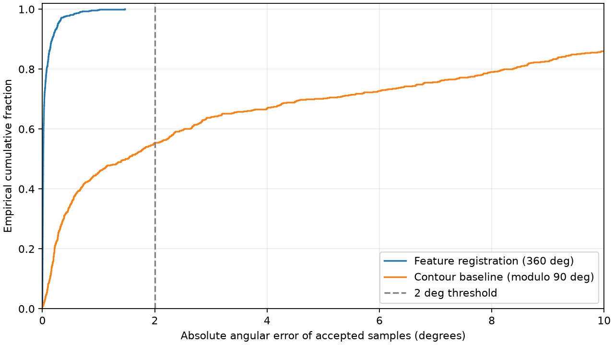

原始来源：`rotation_pose/results/test/error_cdf.png`。

## 02_rgb_accepted.jpg

合成图接受案例。

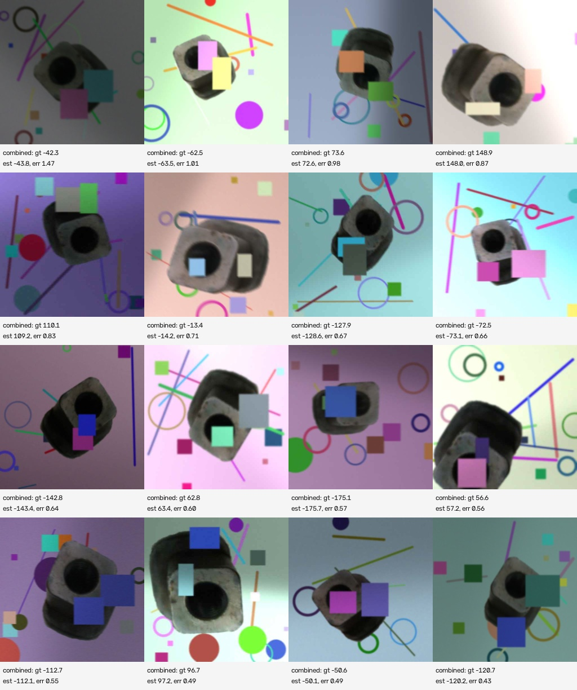

原始来源：`rotation_pose/results/test/accepted.jpg`。

## 03_rgb_rejected.jpg

合成图拒识案例。

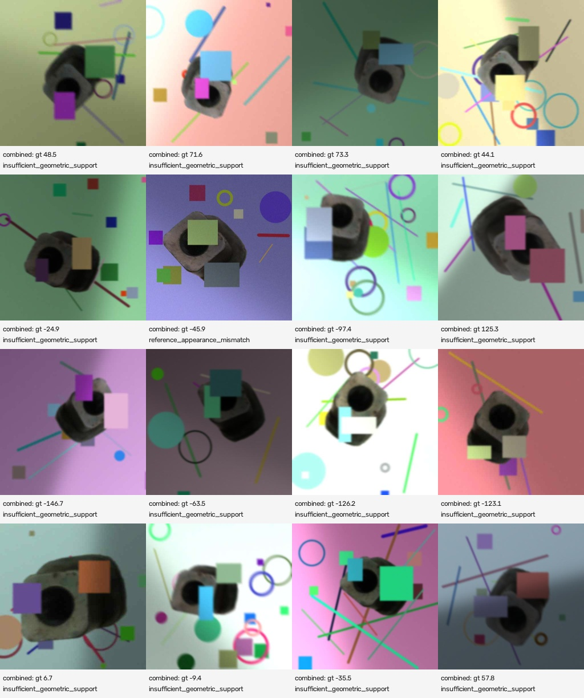

原始来源：`rotation_pose/results/test/rejected.jpg`。

## 04_real_video_directions.jpg

真实视频逐帧二维方向与拒识。

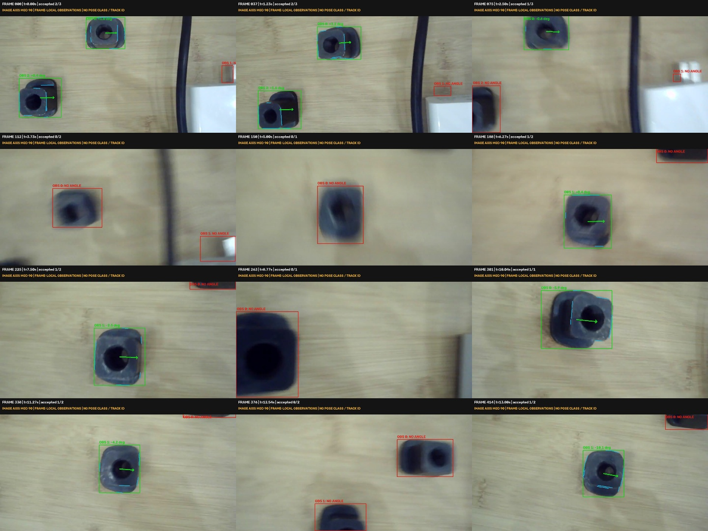

原始来源：`rotation_pose/video_results/all_visible/contact_sheet.jpg`。

## 05_real_video_angles.png

图像模90度角及可测数量。

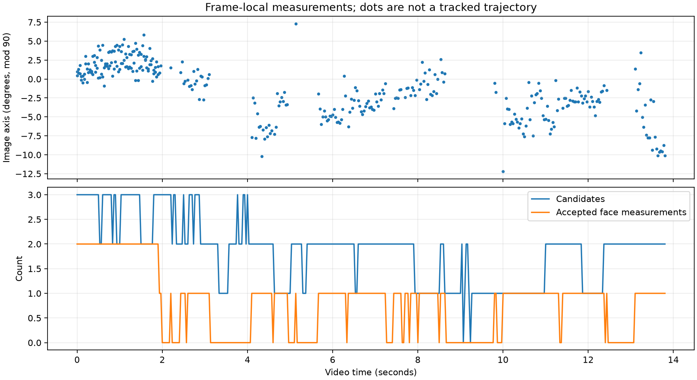

原始来源：`rotation_pose/video_results/all_visible/angles.png`。

## 06_tracking_loss.jpg

出画后目标身份恢复失败分析。

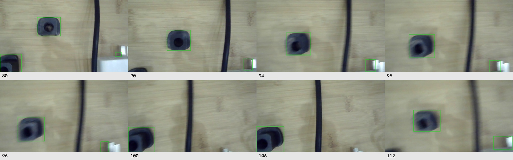

原始来源：`rotation_pose/video_results/tracking_loss.jpg`。

## 07_seg_training_curves.png

分割微调曲线；验证集为自动标签。

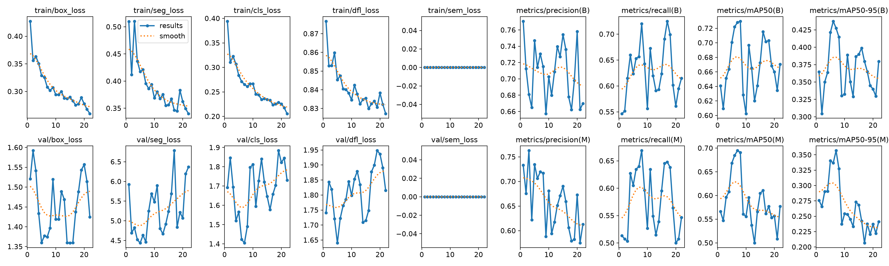

原始来源：`runs/segment/metal_part_yolov8s_seg_refine/results.png`。

## 08_seg_pseudo_labels.jpg

验证批次自动伪标签，不是人工真值。

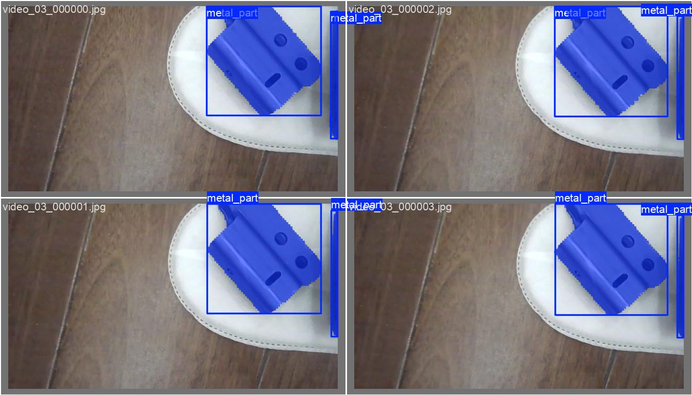

原始来源：`runs/segment/metal_part_yolov8s_seg_refine/val_batch0_labels.jpg`。

## 09_seg_predictions.jpg

对应验证批次预测。

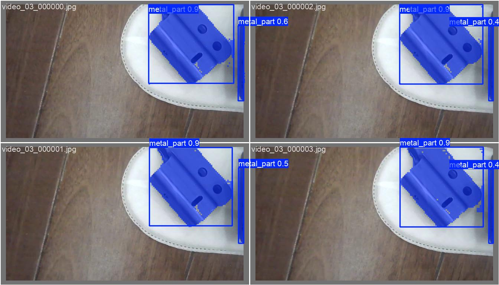

原始来源：`runs/segment/metal_part_yolov8s_seg_refine/val_batch0_pred.jpg`。

## 10_seg_failure_example.jpg

重复检测与漏检案例。

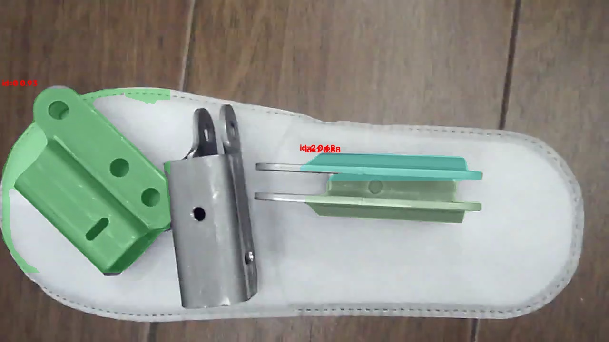

原始来源：`metal_video_annotations/yolo_masks_final/video_03_000056/overlay.jpg`。

## 11_mask_known_rotations.jpg

掩膜二维旋转等变检查，不是实物转角精度。

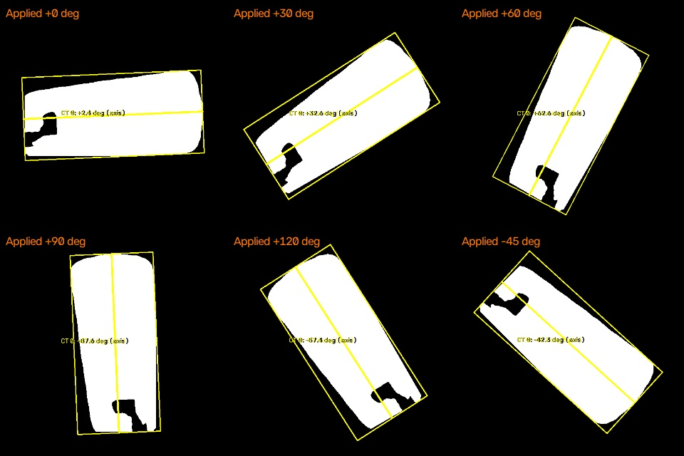

原始来源：`metal_video_annotations/angle_demo/known_rotations.jpg`。

## 12_realsense_rgb.png

D435i 实物彩色输入。

原始来源：`ct_pose_capture/rgb.png`。

## 13_initial_instance_mask.png

FoundationPose 输入单实例掩膜。

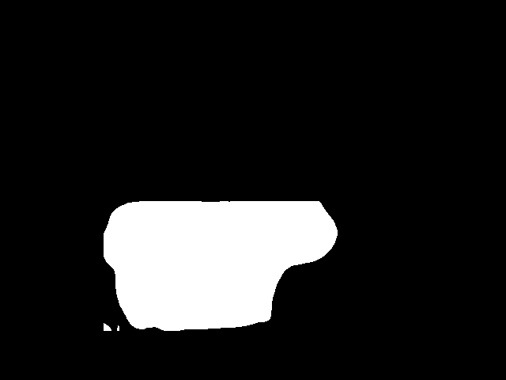

原始来源：`ct_pose_capture/pose/initial_mask.png`。

## 14_cad_contour_overlay.png

CAD 投影外轮廓与实物同帧比较。

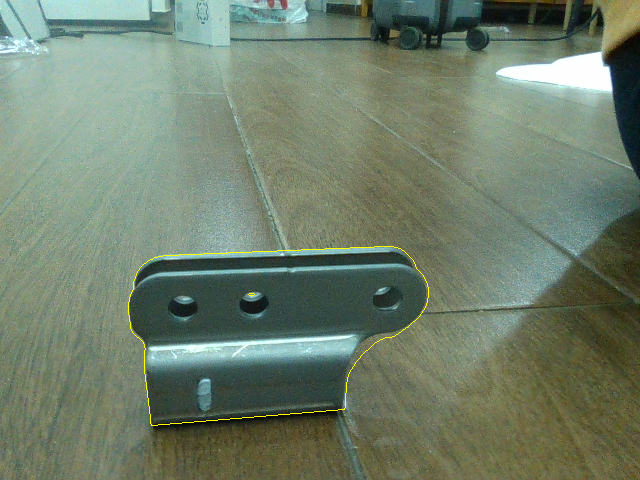

原始来源：`ct_pose_capture/pose/cad_contour_overlay.png`。

## 15_pose_axes_overlay.png

实物初始化三维框和坐标轴。

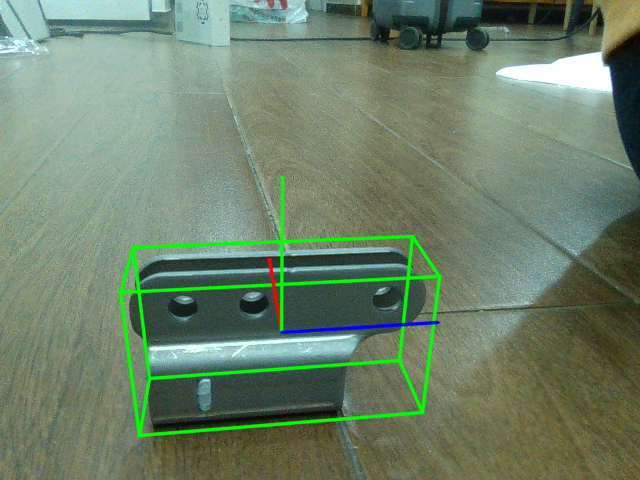

原始来源：`ct_pose_capture/pose/pose_overlay.png`。

## 16_rgbd_tracking_sequence.jpg

150帧实物跟踪中的四个时刻。

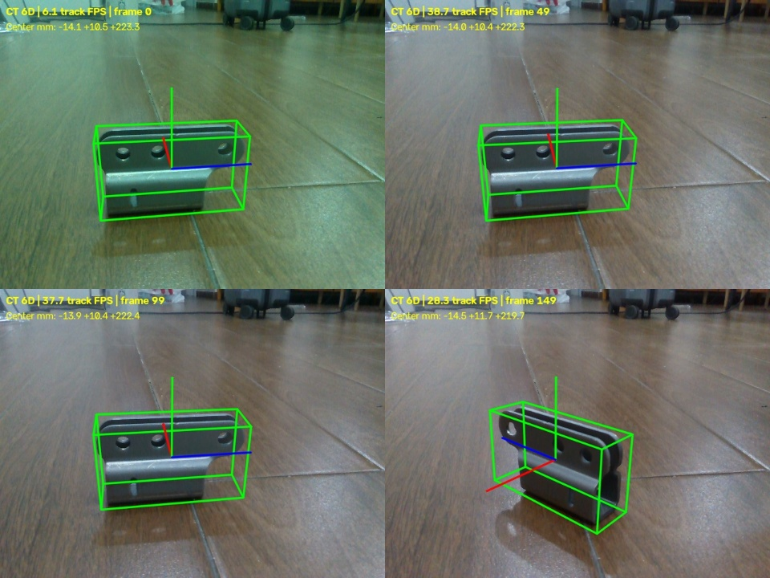

原始来源：`ct_pose_capture/tracking_01/tracking_contact_sheet.jpg`。

## 17_mixed_class_reference.jpeg

从左至右为新 CT、DT、TT；旧 CT 类别不同。

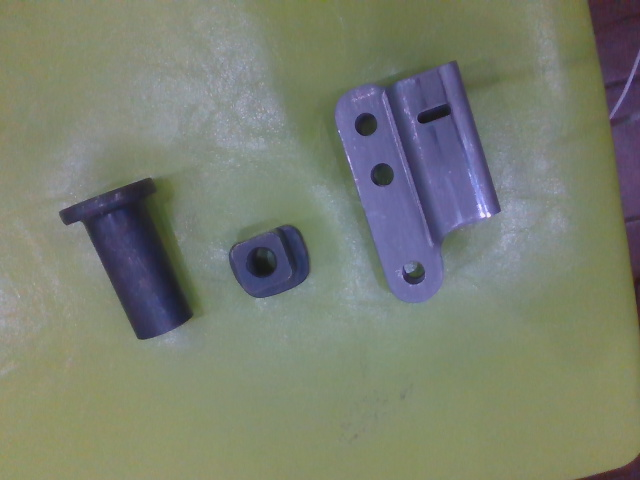

原始来源：`image/混合/Photo from 2026-11-14 21-00-01.599316.jpeg`。

## 18_mixed_annotation_preview.jpg

混合数据提示及标注质量预览，未经人工验收。

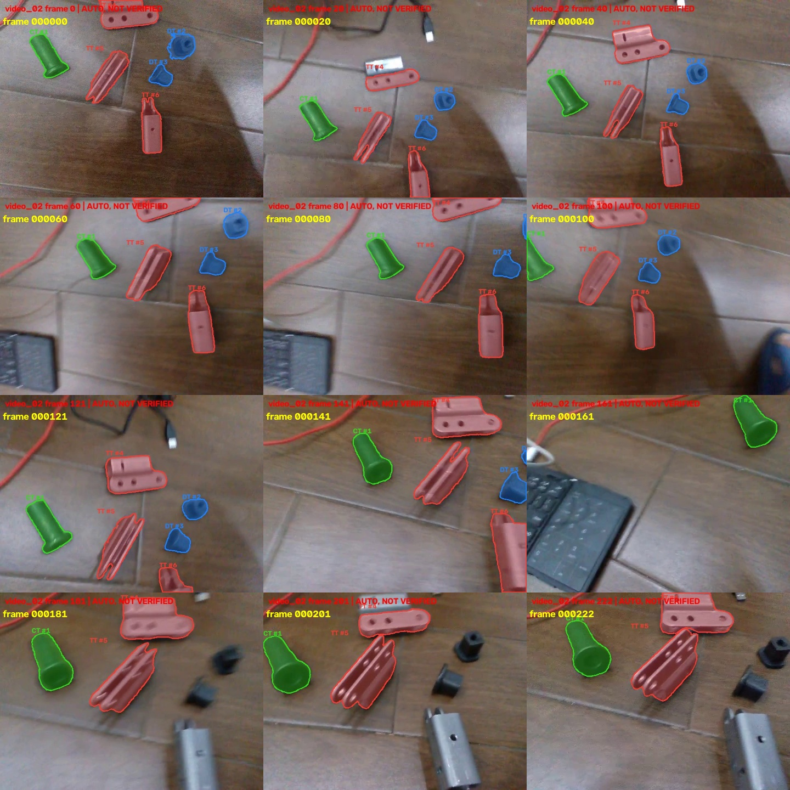

原始来源：`mixed_video_annotations/video_02_quality_preview.jpg`。

## 19_mixed_prompt_review.jpg

混合视频提示坐标复核。

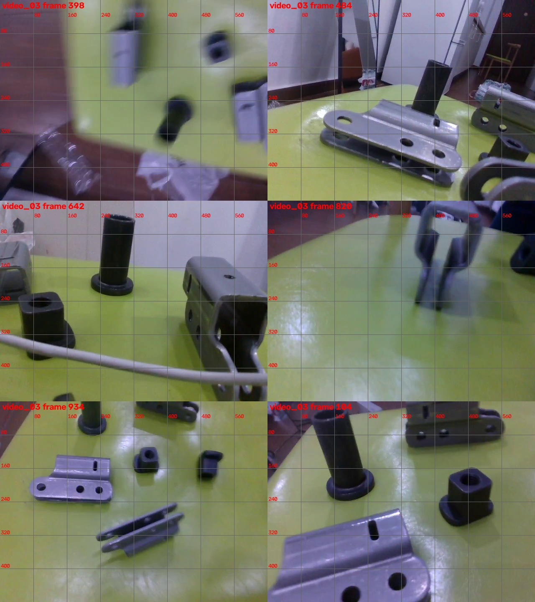

原始来源：`mixed_video_annotations/video_03_coordinate_review.jpg`。

## 视频

[真实视频二维方向演示](videos/01_real_video_directions.mp4)：415 帧，展示模 90° 的图像方向与拒识，不代表机械臂 yaw 或六自由度跟踪。
